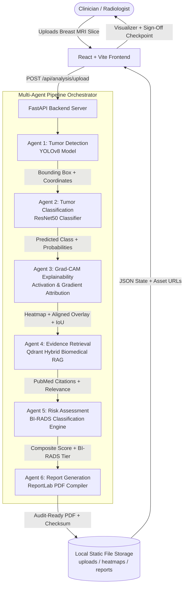

# Breast CARE-MA — System Architecture

**Project:** Breast CARE-MA: An Explainable Multi-Agent AI Framework for Multimodal Breast Cancer Diagnostic Decision Support  
**Institution:** Final-Year B.Tech Information Technology Project  
**Team Members:**
- **Kalaiarasi C (Author):** Medical Imaging & Explainable AI Lead — Frontend (React + Vite) & Agent 3 (Grad-CAM Explainability)
- **Partha Sarathy C:** Project Lead / System Architecture / Multi-Agent Integration
- **Atchaya M:** Agent 1 (Tumor Detection) & Agent 2 (Tumor Classification)
- **Hariharasudhan S:** Agent 4 (Clinical Evidence RAG), Agent 5 (Risk Assessment), Agent 6 (Report Generation)

---

## 1. System Overview

Breast CARE-MA is a modular, research-oriented decision-support prototype designed to bridge the gap between black-box AI model outputs and clinical intelligibility. Rather than providing an autonomous diagnosis, the system assists radiologists and oncologists by synthesizing:
1. Focal lesion localization (YOLOv8)
2. Morphologic classification (ResNet50 / EfficientNet)
3. Visual feature attribution heatmaps (Grad-CAM)
4. Semantic evidence retrieval from peer-reviewed literature (Biomedical RAG)
5. Standardized BI-RADS risk stratification
6. Audit-ready PDF report compilation with human-in-the-loop sign-off

---

## 2. Multi-Agent Pipeline & Data Flow

---

## 3. Technology Stack Alignment

| Layer | Technology | Justification & Role |
| :--- | :--- | :--- |
| **Frontend UI** | React 19 + Vite | High-performance, reactive clinical dashboard with zero build overhead. |
| **Styling** | Vanilla CSS Design System | Custom dark clinical theme (`--bg-app: #080d1a`), glassmorphic panels, accessible high-contrast typography (Inter / Plus Jakarta Sans). |
| **Backend API** | FastAPI + Python 3.14 | Asynchronous, auto-documenting RESTful API with Pydantic v2 data validation. |
| **Detection AI** | YOLOv8 (Agent 1) | Fast, localized focal lesion boundary extraction on axial breast MRI slices. |
| **Classification AI**| ResNet50 (Agent 2) | Deep convolutional residual network predicting Normal, Benign, or Malignant. |
| **Visual XAI** | Grad-CAM Engine (Agent 3) | Mathematical gradient-weighted activation mapping on deep bottleneck layers (`layer4`). |
| **Evidence RAG** | Qdrant + PubMed (Agent 4) | Vector semantic similarity retrieval matching MRI findings to clinical trials. |
| **Risk Scoring** | BI-RADS Lexicon (Agent 5) | Standard American College of Radiology BI-RADS categories (1 through 5). |
| **Report Engine** | ReportLab 5.1 (Agent 6) | Generates high-resolution PDF clinical summaries with embedded Grad-CAM overlays. |
